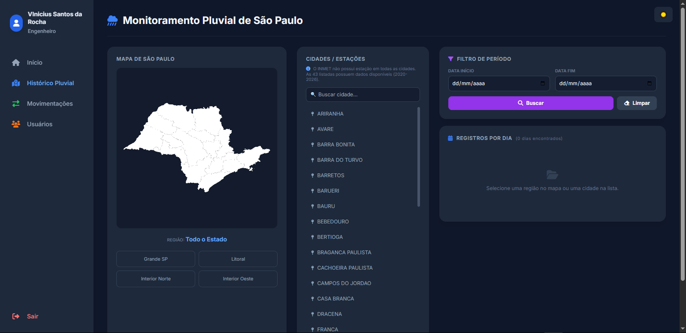
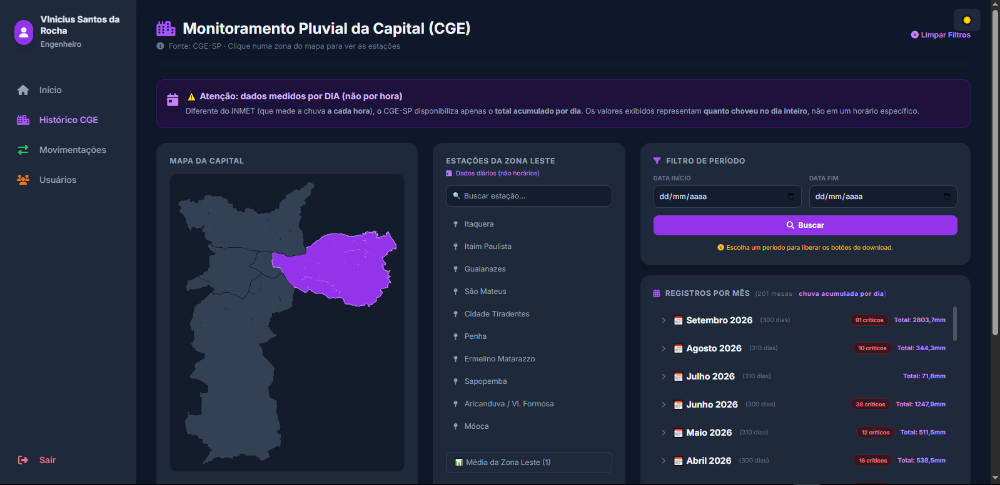
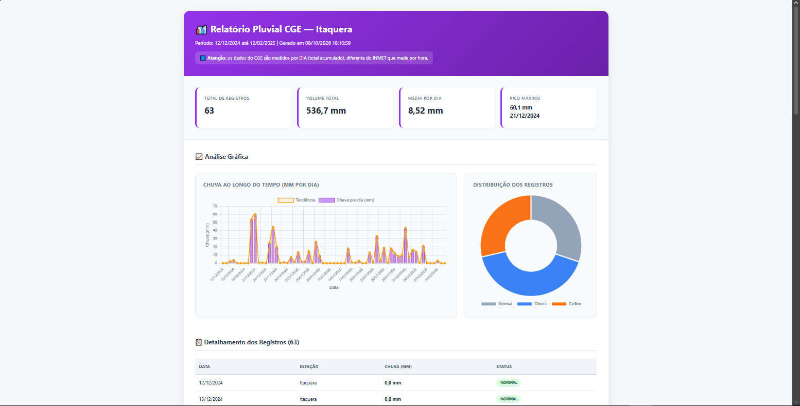
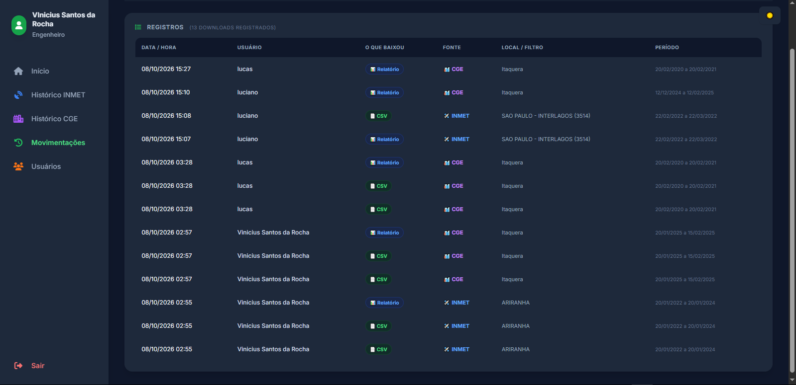

# 🌧️ Sistema Pluvit — Monitoramento Pluvial de São Paulo

Pipeline ETL completo que consolida dados pluviométricos de duas fontes oficiais brasileiras (**INMET** e **CGE-SP**) e disponibiliza um painel web interativo para análise de chuvas no estado de São Paulo.

## 📌 Sobre o projeto

**Problema resolvido:** engenheiros e gestores de obras precisam de dados históricos de chuva para avaliar riscos de paralisação. Esses dados estavam dispersos em **3.716 arquivos** de formatos diferentes (CSV do INMET e Excel do CGE), sem padronização.

**Solução:** pipeline automatizado em Python que extrai, transforma e carrega os dados em um banco MySQL otimizado, com interface web para consulta, filtragem e exportação.

## 📊 Resultados

| Métrica | Valor |
|---|---|
| Arquivos processados | **3.716 arquivos** |
| Linhas consolidadas | **2.250.352 linhas** |
| Período coberto | **2010 a 2026** (17 anos) |
| Estações meteorológicas | **84 estações** |
| Fontes de dados | **2** (INMET + CGE-SP) |

## 🛠️ Tecnologias utilizadas

- **Python** (pandas, geopandas, shapely) — pipeline ETL e geração de mapas vetoriais
- **MySQL** — armazenamento e otimização (índices)
- **PHP** — interface web de consulta
- **JavaScript** (Chart.js) — gráficos e visualizações
- **Git/GitHub** — versionamento

## 🏗️ Arquitetura do pipeline

**Fluxo:**
1. **Extração:** leitura de 3.716 arquivos CSV (INMET) e XLSX (CGE)
2. **Transformação:** limpeza de encoding, padronização de datas, conversão de decimais, mapeamento de regiões
3. **Carga:** importação de 2,25 milhões de linhas via `LOAD DATA LOCAL INFILE`
4. **Otimização:** criação de índices compostos
5. **Visualização:** interface PHP com mapa SVG interativo

## 📸 Screenshots

### Menu principal


### Painel INMET (estado de SP)


### Painel CGE (capital de SP)


### Relatório com gráficos


### Auditoria de downloads


## 🚀 Como rodar

### Pré-requisitos
- Python 3.10+
- MySQL 8.0+
- WampServer (ou Apache + PHP)

### Instalação

Clone o repositório:
```bash
git clone https://github.com/Vinicius-S-R/pluvit-monitoramento-pluvial.git
cd pluvit-monitoramento-pluvial
Instale as dependências Python:

bash
pip install -r requirements.txt
Crie o banco de dados:

bash
mysql -u root -p < sql/criar_tabelas.sql
Execute a pipeline:

bash
python pipeline/consolidar_inmet.py
python pipeline/consolidar_cge.py
📁 Estrutura do projeto
text
pluvit-monitoramento-pluvial/
├── pipeline/       # Scripts Python de ETL
├── web/            # Interface PHP + HTML
├── sql/            # Scripts de criação do banco
├── mapa/           # Mapas SVG interativos
├── imagens/        # Screenshots do sistema
├── dados/          # Documentação sobre os dados
└── README.md       # Este arquivo
🤖 Nota sobre uso de IA
Este projeto foi desenvolvido como projeto de portfólio e aprendizado. Usei ferramentas de IA como apoio para depurar erros de sintaxe, aprender bibliotecas específicas (pandas, geopandas) e revisar boas práticas. Veja mais detalhes em AI-DECLARATION.md.

📫 Contato
LinkedIn: https://www.linkedin.com/in/vinicius-rocha-cloud/

Email: vyni2008@gmail.com